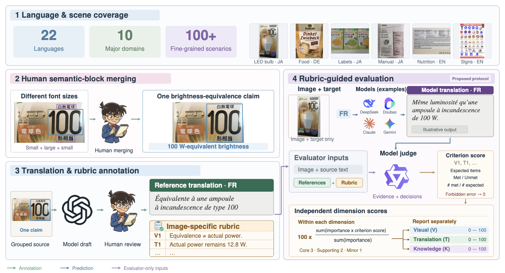
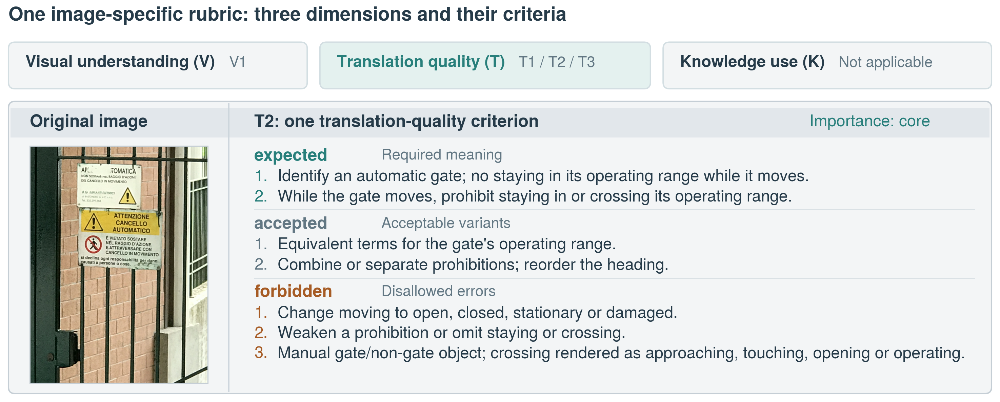
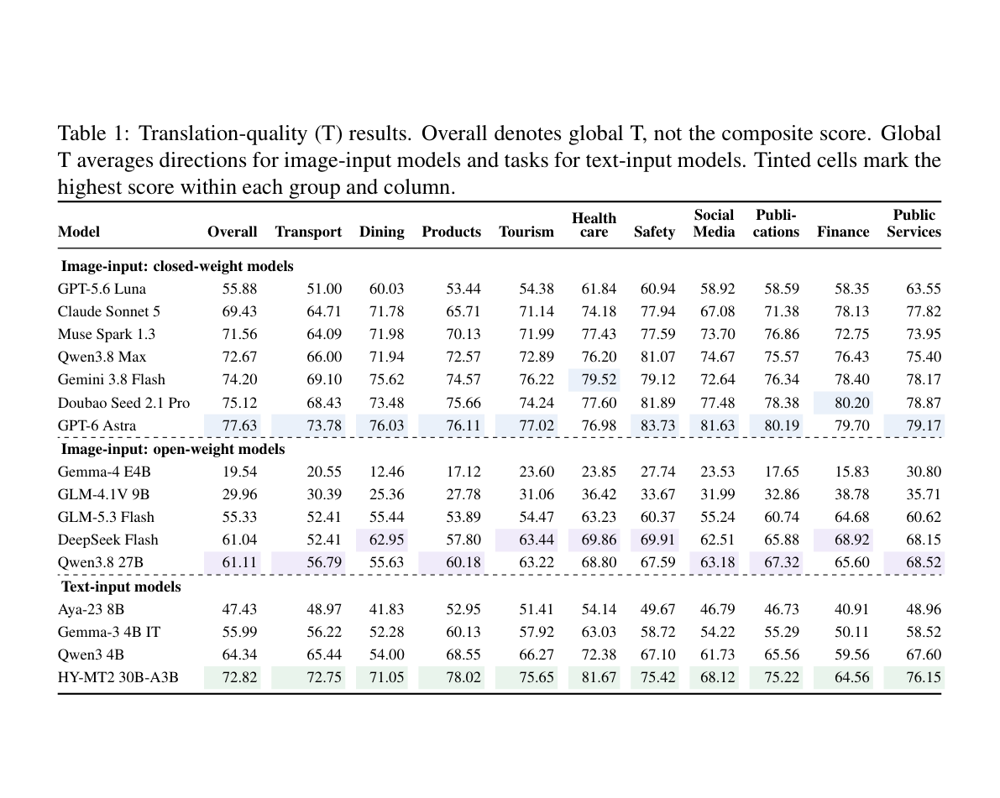

# VISTA-Bench

A multilingual benchmark for evaluating translation from real-world images and released OCR.

面向真实世界图像与公开 OCR 的多语言翻译评测基准。

<p align="center">
  <a href="https://github.com/lvbotenbest/VISTA-BENCH">GitHub Code</a> ·
  <a href="https://huggingface.co/datasets/lvpokoto/VISTA-Bench">🤗 Hugging Face Dataset</a> ·
  <a href="https://arxiv.org/abs/2609.37287">Paper</a>
</p>

<p align="center">
  
</p>

<p align="center">
  
</p>

## Paper Results

<p align="center">
  
</p>

<p align="center"><sub>Paper Table 1. Overall denotes global translation quality (T), not a composite of V, T, and K.</sub></p>

<details open>
<summary><strong>中文（默认展开）</strong></summary>

## 概览

VISTA-Bench 覆盖 23 种源语言与 10 类日常场景。每张图像配有 OCR、人工核验翻译，以及两套评测规则：面向强模型、保留较难规则的 `rubric`，以及面向小模型、规则本身更简单的 `basic_rubric`。候选模型生成翻译后，由**只接收文本的 judge**按目标语言 rubric 检查，最后使用确定性的 `scoring` 计分并汇总。我们将持续更新数据集，进一步丰富图片数量、覆盖语种与应用场景。

## Quick Start

需要 Python 3.11 或更高版本（脚本使用标准库 `tomllib`）。

```bash
python -m venv .venv
. .venv/bin/activate
python -m pip install -r requirements.txt
```

代码仓库不包含数据。首次运行前，从 Hugging Face 下载 `data/`：

```bash
python -m pip install -U huggingface_hub
hf download lvpokoto/VISTA-Bench \
  --repo-type dataset \
  --include "data/**" \
  --local-dir .
```

### 1. 无参数交互运行

统一入口会询问 track、rubric、API、模型、目标语言、任务上限和输出目录；密钥使用隐藏输入，不写入仓库。

```bash
python run_benchmark.py
```

### 2. 三任务 smoke run

先把密钥放入环境变量，再运行 3 个任务。`--target-lang` 使用数据中的语言代码；例如简体中文为 `zh-Hans`。

```bash
export VISTA_API_KEY='your-secret-value'

python run_benchmark.py \
  --non-interactive \
  --api-url https://api.example.com/v1 \
  --key-env VISTA_API_KEY \
  --candidate-model your-candidate-model \
  --judge-model your-judge-model \
  --endpoint chat/completions \
  --track image \
  --rubric-set rubric \
  --target-lang zh-Hans \
  --limit 3 \
  --output-dir outputs/smoke \
  --candidate-workers 2 \
  --judge-workers 2
```

可在发出请求前用同一命令追加 `--dry-run`，检查任务选择和运行计划。

### 3. 完整 CLI

下面展示统一入口的全部常用控制项。删除 `--limit` 即评测全部匹配任务；重复 `--target-lang` 可选择多个目标语言。

```bash
python run_benchmark.py \
  --non-interactive \
  --api-url https://api.example.com/v1 \
  --key-env VISTA_API_KEY \
  --candidate-model your-candidate-model \
  --judge-model your-judge-model \
  --endpoint responses \
  --track image \
  --rubric-set rubric \
  --target-lang zh-Hans \
  --target-lang es \
  --output-dir outputs/full-image-rubric \
  --candidate-workers 8 \
  --judge-workers 8 \
  --max-attempts 3 \
  --timeout-seconds 120
```

## 统一入口参数

| 参数 | 说明 |
|---|---|
| `--interactive` | 强制进入交互向导；无参数且终端可交互时默认启用。 |
| `--non-interactive` | 禁止提示输入，适合 CI；所需参数与密钥环境变量必须预先提供。 |
| `--api-url` | OpenAI-compatible API base URL；不要在 URL 中嵌入密钥。 |
| `--key-env` | 保存 API key 的环境变量**名称**，不是密钥值。 |
| `--candidate-model` | 生成候选翻译的模型名。 |
| `--judge-model` | 文本 judge 的模型名；可与 candidate 不同。 |
| `--endpoint` | `chat/completions` 或 `responses`。 |
| `--track` | `image` 或 `text`。 |
| `--rubric-set` | `rubric`：筛选保留难规则，推荐能力较强的模型；`basic_rubric`：规则本身更简单，推荐小模型或能力较弱模型。 |
| `--target-lang` | 按目标语言过滤；可重复，例如 `zh-Hans`、`es`。 |
| `--limit` | 只运行筛选后最前面的 N 个任务；适合 smoke test。 |
| `--output-dir` | 本次运行的产物目录。 |
| `--resume` | 从兼容的既有输出继续，跳过已完成项。 |
| `--dry-run` | 只检查配置和任务计划，不发 API 请求。 |
| `--candidate-workers` | candidate 阶段并发数。 |
| `--judge-workers` | judge 阶段并发数。 |
| `--max-attempts` | 每个 API 阶段的最大正常尝试次数，范围 1–3。 |
| `--timeout-seconds` | 单次 API 请求超时秒数。 |

Candidate 与 judge 通常可以共用 `--api-url`、`--endpoint` 和 `--key-env`，但通过 `--candidate-model` 与 `--judge-model` 使用不同模型。

## 流程与 tracks

1. **任务选择：**从当前 manifest 选择图像、源语言和目标语言方向。
2. **Candidate：**image track 输入图像；text track 仅输入公开 OCR。两者都输出 self-segmented candidate blocks。
3. **Text-only judge：**接收源文本块、candidate blocks、目标语言 criteria 与 tolerances；**永远不接收图像或参考译文**。
4. **Scoring：**`scoring` 对 judge checklist 做确定性计算。
5. **Summary：**生成 coverage、按 V/T/K 分开的方向分数、领域分数与独立排名。

两个 track 是不同的比较组：

- **Image track：**candidate 看图；可评估图像理解、翻译质量和知识蕴含。
- **Text track：**candidate 只看 OCR；视觉 criteria 在 judge 和计分前被移除。

Image 与 text 是独立比较组，分数**不可直接比较，也不能混入同一个 leaderboard**。两者都分别报告适用的 V（图像理解）、T（翻译质量）与 K（知识蕴含）维度，不做跨维度加权或重归一化。

## Rubrics

### `rubric`

主要评测集合，推荐能力较强的模型使用。该集合筛选并保留较难的评测规则，用于区分强模型的能力。

### `basic_rubric`

面向小模型或能力较弱模型的基础规则集。这里的 “basic” 表示每条规则的判定要求更简单，而不是规则数量更少；按当前目标语言投影，`basic_rubric` 的 criterion instances 反而比 `rubric` 更多。底层发布资产仍存放在 `data/simple_rubric/`，仅保留该目录名以兼容既有数据清单。

两套 rubric 代表不同评测条件，必须分别汇总和排名，不能混榜。零 criterion 任务不会调用 judge，会记为 `unscorable`；它不是数值零，也不是 API 失败。

## 评分

- 每个 expected atom 只做二值判定：`met = 1`、`unmet = 0`；只有完全满足才是 `met`，部分满足必须判为 `unmet`，judge 不接受 `partial`。
- Criterion 分数 = 完全命中的 expected atom 数 / expected atom 总数；任一 forbidden atom 命中时，对应 criterion 直接记为 0。
- V（图像理解）、T（翻译质量）与 K（知识蕴含）分别计分。每个维度内部按 criterion importance 加权：`core = 3`、`supporting = 2`、`minor = 1`。
- 维度之间不使用权重，不计算 composite `overall`，也不因维度缺失而重归一化。
- 三个维度分别聚合、分别排名；同一个 `leaderboard.csv` 同时保存 V/T/K 分数和三个独立 rank。两套 rubric 仍各自生成 leaderboard，不能混榜。
- Null、失败和 unscorable 任务排除；合法数值零仍保留。

## 输出与 resume

`--output-dir` 中包含：

| 文件 | 内容 |
|---|---|
| `run.json` | 无密钥的运行参数、阶段状态和计数；resume 的兼容性依据。 |
| `candidates.jsonl` | Self-segmented 候选翻译。 |
| `candidate_failures.jsonl` | Candidate 失败记录，便于审计和重试。 |
| `judgments.jsonl` | Text-only judge 的逐任务 checklist 结果。 |
| `scores.jsonl` | `scoring` 的逐任务 criterion 明细、V/T/K 维度分数与状态；不含 composite `overall`。 |
| `summary.json` | Profile、rubric、coverage、V/T/K 聚合规则与三个独立排名的摘要。 |
| `leaderboard.csv` | 在同一张表中保存 V/T/K 分数及三个独立 rank；不含 composite `overall` rank。 |
| `coverage.csv` | 成功、失败与 unscorable 覆盖统计。 |
| `scores_by_direction.csv` | 按源语言→目标语言分别汇总 V/T/K。 |
| `scores_by_direction_level1.csv` | 按源语言→目标语言×一级领域分别汇总 V/T/K。 |
| `scores_by_level1.csv` | 按一级领域对有效方向做等权 macro，分别汇总 V/T/K。 |

使用 `--resume` 时必须指向原输出目录。入口会复用相同的 track、rubric、模型、API 配置、目标语言和任务范围，跳过有效的 candidate/judge 记录，并重新生成确定性 score 与 summary。若核心参数不同，请使用新的输出目录；不要手工拼接不同 track、rubric 或模型的 JSONL。

## 数据目录

- `data/manifest.jsonl`：样本及资产索引。
- `data/images/`、`data/ocr/`、`data/verified_translations/`：图像、OCR 与核验翻译。
- `data/simple_rubric/`：`basic_rubric` 的底层兼容目录。
- `data/rubric/`：强模型使用的难规则集合。
- `script/`：candidate、judge、scoring、summarize 脚本及 schema。

## 独立脚本（高级用法）

一般用户应使用 `python run_benchmark.py`。只有需要自定义中间产物或研究 pipeline 细节时，才复制并编辑 `config.example.toml`：

```bash
cp config.example.toml config.toml
export VISTA_API_KEY='your-secret-value'

python script/generate_image_candidates.py \
  --config config.toml \
  --output outputs/image_candidates.jsonl \
  --failures-output outputs/image_candidate_failures.jsonl \
  --workers 8 --max-attempts 3 --resume

python script/judge.py \
  --config config.toml \
  --candidates outputs/image_candidates.jsonl \
  --rubric-set rubric \
  --profile image \
  --output outputs/image_judgments.jsonl \
  --workers 8 --max-attempts 3 --resume

python script/scoring.py \
  --judge-records outputs/image_judgments.jsonl \
  --rubric-set rubric \
  --profile image \
  --output outputs/image_scores.jsonl

python script/summarize.py \
  --scores model-a=outputs/image_scores.jsonl \
  --profile image \
  --rubric-set rubric \
  --output-dir outputs/image_summary
```

Text track 将第一条命令换成 `script/generate_text_candidates.py`，并在 judge、scoring、summarize 中使用 `--profile text`。不要跨 profile 或 rubric 合并 summary。

## 引用

如果这个项目对你的研究有帮助，请引用：

```bibtex
@misc{lv2026vistabenchbenchmarkingmultilingualimage,
  title={VISTA-Bench: Benchmarking Multilingual Image Translation with Image-Specific Rubrics},
  author={Bo Lv and Mao Zheng and Zheng Li and Fangxu Liu and Mingrui Sun and Tao Chen},
  year={2026},
  eprint={2609.37287},
  archivePrefix={arXiv},
  primaryClass={cs.CV},
  url={https://arxiv.org/abs/2609.37287}
}
```

</details>

<details>
<summary><strong>English</strong></summary>

## Overview

VISTA-Bench covers 23 source languages and 10 everyday-use domains. Each image is paired with OCR, verified translations, and two evaluation rule sets: `rubric`, which retains harder criteria for stronger models, and `basic_rubric`, whose criteria are intentionally easier for smaller models. A candidate model produces a translation, a **text-only judge** evaluates it against the target-language rubric, and deterministic `scoring` produces task scores and aggregates. We will continue updating the dataset with more images, languages, and application scenarios.

## Quick Start

Python 3.11 or later is required because the scripts use the standard-library `tomllib` module.

```bash
python -m venv .venv
. .venv/bin/activate
python -m pip install -r requirements.txt
```

The code repository does not contain the dataset. Download `data/` from Hugging Face before the first run:

```bash
python -m pip install -U huggingface_hub
hf download lvpokoto/VISTA-Bench \
  --repo-type dataset \
  --include "data/**" \
  --local-dir .
```

### 1. Interactive run with no arguments

The unified entry point asks for the track, rubric, API, models, target languages, task limit, and output directory. A directly entered key uses hidden input and is not written to the repository.

```bash
python run_benchmark.py
```

### 2. Three-task smoke run

Store the key in an environment variable, then run three tasks. `--target-lang` uses the language codes in the dataset; Simplified Chinese is `zh-Hans`.

```bash
export VISTA_API_KEY='your-secret-value'

python run_benchmark.py \
  --non-interactive \
  --api-url https://api.example.com/v1 \
  --key-env VISTA_API_KEY \
  --candidate-model your-candidate-model \
  --judge-model your-judge-model \
  --endpoint chat/completions \
  --track image \
  --rubric-set rubric \
  --target-lang zh-Hans \
  --limit 3 \
  --output-dir outputs/smoke \
  --candidate-workers 2 \
  --judge-workers 2
```

Append `--dry-run` to the same command to inspect task selection and the execution plan before sending requests.

### 3. Full CLI

The following example shows all common controls. Remove `--limit` to evaluate every matching task. Repeat `--target-lang` to select multiple targets.

```bash
python run_benchmark.py \
  --non-interactive \
  --api-url https://api.example.com/v1 \
  --key-env VISTA_API_KEY \
  --candidate-model your-candidate-model \
  --judge-model your-judge-model \
  --endpoint responses \
  --track image \
  --rubric-set rubric \
  --target-lang zh-Hans \
  --target-lang es \
  --output-dir outputs/full-image-rubric \
  --candidate-workers 8 \
  --judge-workers 8 \
  --max-attempts 3 \
  --timeout-seconds 120
```

## Unified entry-point options

| Option | Meaning |
|---|---|
| `--interactive` | Force the setup wizard; it is the default for an argument-free interactive terminal. |
| `--non-interactive` | Disable prompts for CI; all required values and the key environment variable must already exist. |
| `--api-url` | OpenAI-compatible API base URL; never embed a key in the URL. |
| `--key-env` | **Name** of the environment variable holding the API key, not the key value. |
| `--candidate-model` | Model that generates candidate translations. |
| `--judge-model` | Text-judge model; it may differ from the candidate model. |
| `--endpoint` | `chat/completions` or `responses`. |
| `--track` | `image` or `text`. |
| `--rubric-set` | `rubric`: retains selected hard rules for stronger models; `basic_rubric`: uses easier individual criteria for smaller or less capable models. |
| `--target-lang` | Filter by target language; repeat for values such as `zh-Hans` and `es`. |
| `--limit` | Run only the first N selected tasks; useful for smoke tests. |
| `--output-dir` | Directory for this run's artifacts. |
| `--resume` | Continue a compatible output directory and skip completed work. |
| `--dry-run` | Validate configuration and print the plan without making API requests. |
| `--candidate-workers` | Candidate-stage concurrency. |
| `--judge-workers` | Judge-stage concurrency. |
| `--max-attempts` | Maximum normal attempts per API stage, from 1 to 3. |
| `--timeout-seconds` | Per-request API timeout in seconds. |

Candidate and judge can normally share `--api-url`, `--endpoint`, and `--key-env`, while using different values for `--candidate-model` and `--judge-model`.

## Pipeline and tracks

1. **Task selection:** select image, source-language, and target-language directions from the current manifest.
2. **Candidate:** the image track receives the image; the text track receives released OCR only. Both produce self-segmented candidate blocks.
3. **Text-only judge:** receives source blocks, candidate blocks, target-specific criteria, and tolerances; it **never receives the image or reference translation**.
4. **Scoring:** `scoring` deterministically evaluates the judge checklist.
5. **Summary:** produces coverage, separate V/T/K direction and domain scores, and independent rankings.

The tracks are separate comparison groups:

- **Image track:** the candidate sees the image; image understanding, translation quality, and knowledge entailment can be evaluated.
- **Text track:** the candidate sees OCR only; visual criteria are removed before judging and scoring.

Image and text are separate comparison groups: their scores are **not directly comparable and must not be mixed in one leaderboard**. Both report the applicable V (visual understanding), T (translation quality), and K (knowledge entailment) dimensions separately, with no cross-dimension weighting or renormalization.

## Rubrics

### `rubric`

The primary evaluation collection, recommended for stronger models. It selects and retains hard evaluation rules to differentiate stronger model capabilities.

### `basic_rubric`

The baseline rule set for smaller or less capable models. “Basic” means that each criterion is easier to satisfy, not that the set contains fewer criteria; under the current target-language projections, `basic_rubric` has more criterion instances than `rubric`. Its release assets remain under `data/simple_rubric/` only to preserve compatibility with the existing data manifest.

The two rubric sets represent different evaluation conditions and must be aggregated and ranked separately; they must never share a leaderboard. A zero-criterion task makes no judge request and is recorded as `unscorable`; it is neither a numeric zero nor an API failure.

## Scoring

- Each expected atom is binary: `met = 1` or `unmet = 0`. Only full satisfaction is `met`; partial satisfaction must be `unmet`, and the judge does not accept `partial`.
- Criterion score = fully met expected-atom count / total expected-atom count. If any forbidden atom matches, that criterion is set to 0.
- V (visual understanding), T (translation quality), and K (knowledge entailment) are scored separately. Within each dimension, criterion importance is weighted as `core = 3`, `supporting = 2`, and `minor = 1`.
- Dimensions have no cross-dimension weights. No composite `overall` is computed, and missing dimensions are not renormalized.
- The three dimensions are aggregated and ranked independently. One `leaderboard.csv` stores V/T/K scores and three independent ranks; each rubric set still has its own leaderboard and the two sets must not be mixed.
- Null, failed, and unscorable tasks are excluded; valid numeric zeros remain included.

## Outputs and resume

`--output-dir` contains:

| File | Contents |
|---|---|
| `run.json` | Key-free run parameters, stage status, and counts; the resume compatibility record. |
| `candidates.jsonl` | Self-segmented candidate translations. |
| `candidate_failures.jsonl` | Candidate failures for audit and retry. |
| `judgments.jsonl` | Per-task checklist results from the text-only judge. |
| `scores.jsonl` | Per-task criterion details, V/T/K dimension scores, and statuses; no composite `overall`. |
| `summary.json` | Profile, rubric, coverage, V/T/K aggregation rules, and three independent ranking summaries. |
| `leaderboard.csv` | V/T/K scores and three independent ranks in one table; no composite `overall` rank. |
| `coverage.csv` | Success, failure, and unscorable coverage. |
| `scores_by_direction.csv` | Separate V/T/K source-to-target aggregates. |
| `scores_by_direction_level1.csv` | Separate V/T/K source-to-target × top-level-domain aggregates. |
| `scores_by_level1.csv` | Separate V/T/K top-level-domain macros over valid directions. |

`--resume` must point to the original output directory. The entry point reuses the same track, rubric, models, API settings, target languages, and task scope, skips valid candidate/judge records, and regenerates deterministic scores and summaries. Use a new output directory when core parameters change. Do not manually concatenate JSONL from different tracks, rubrics, or models.

## Data directories

- `data/manifest.jsonl`: sample and asset index.
- `data/images/`, `data/ocr/`, `data/verified_translations/`: images, OCR, and verified translations.
- `data/simple_rubric/`: compatibility directory backing `basic_rubric`.
- `data/rubric/`: harder criteria for stronger models.
- `script/`: candidate, judge, scoring, and summarization scripts plus schemas.

## Standalone scripts (advanced)

Most users should run `python run_benchmark.py`. Copy and edit `config.example.toml` only when custom intermediate files or pipeline research require the standalone scripts:

```bash
cp config.example.toml config.toml
export VISTA_API_KEY='your-secret-value'

python script/generate_image_candidates.py \
  --config config.toml \
  --output outputs/image_candidates.jsonl \
  --failures-output outputs/image_candidate_failures.jsonl \
  --workers 8 --max-attempts 3 --resume

python script/judge.py \
  --config config.toml \
  --candidates outputs/image_candidates.jsonl \
  --rubric-set rubric \
  --profile image \
  --output outputs/image_judgments.jsonl \
  --workers 8 --max-attempts 3 --resume

python script/scoring.py \
  --judge-records outputs/image_judgments.jsonl \
  --rubric-set rubric \
  --profile image \
  --output outputs/image_scores.jsonl

python script/summarize.py \
  --scores model-a=outputs/image_scores.jsonl \
  --profile image \
  --rubric-set rubric \
  --output-dir outputs/image_summary
```

For the text track, replace the first command with `script/generate_text_candidates.py` and use `--profile text` for judge, scoring, and summarization. Never combine profiles or rubric sets in one summary.

## Citation

If you find this project useful for your research, please cite:

```bibtex
@misc{lv2026vistabenchbenchmarkingmultilingualimage,
  title={VISTA-Bench: Benchmarking Multilingual Image Translation with Image-Specific Rubrics},
  author={Bo Lv and Mao Zheng and Zheng Li and Fangxu Liu and Mingrui Sun and Tao Chen},
  year={2026},
  eprint={2609.37287},
  archivePrefix={arXiv},
  primaryClass={cs.CV},
  url={https://arxiv.org/abs/2609.37287}
}
```

</details>
